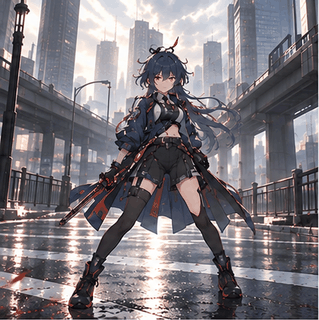

# 人物与动作库

把一次性的交接材料收敛为可检索、可预览、可组合的动作素材。每个动作包含人物标识、原始姿态表、逐格图像、时长、GIF 预览、非连续循环标记与观察到的限制。

当前示例是 [sword-swing](actions/sword-swing/manifest.json)：



它是八个生成姿态的切换预览，最后到第一格有重置，不能标成无缝循环。增加格数也不自动带来连续动画。此模块不负责完整故事、声音或滑脚量测。

```sh
python media-video/动图与动作库制作/build_preview.py media-video/动图与动作库制作/actions/sword-swing
```

后续先扩展同一人物的待机、转头、拿取、蹲下与短步，再建立不同视角和服装版本。人物身份与动作分开命名，但图像保持整张场景，不要求拆出透明角色。把实际可复用性、接触与遮挡问题交给 有限动画与低成本静态视频流 评估，再供 环境互动视频流 选用。
